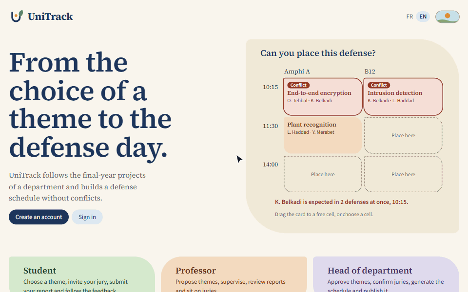
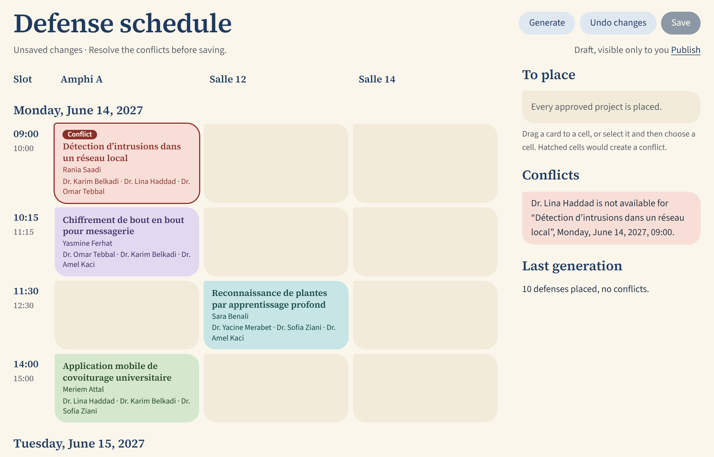
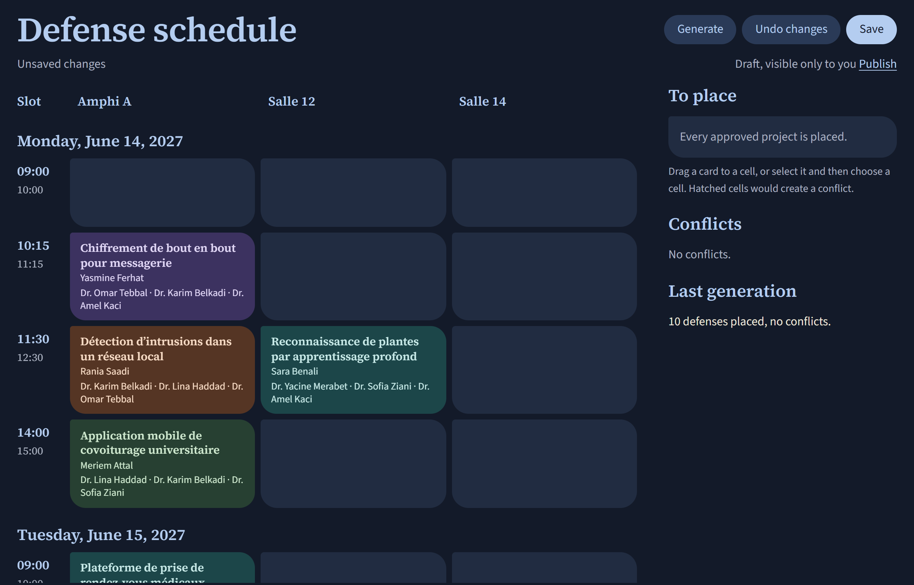
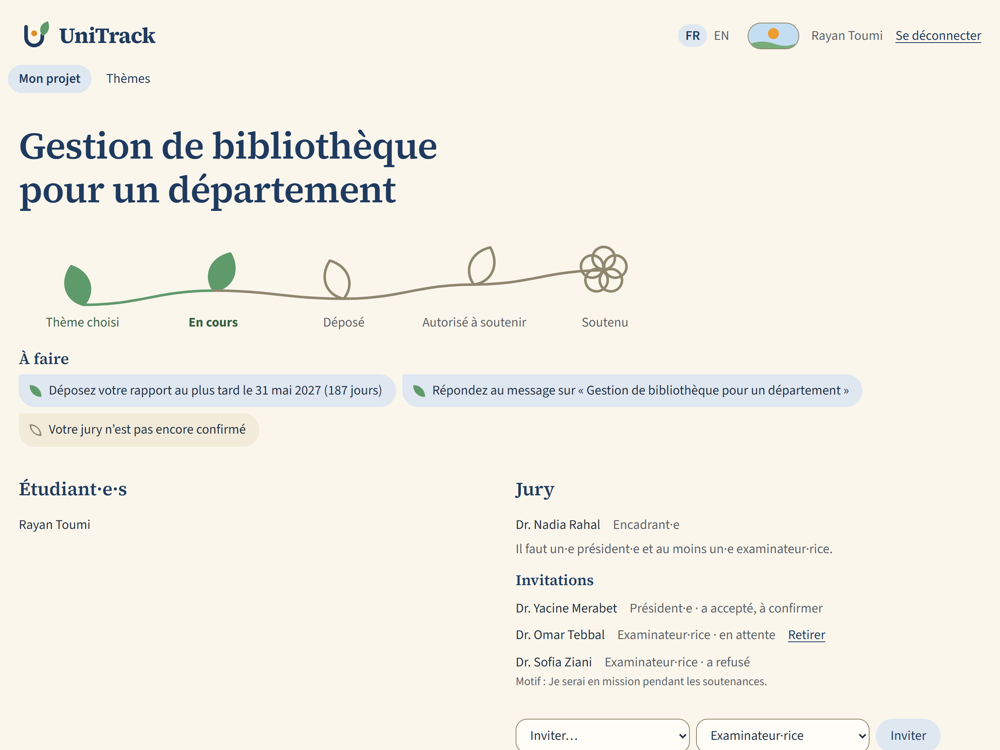
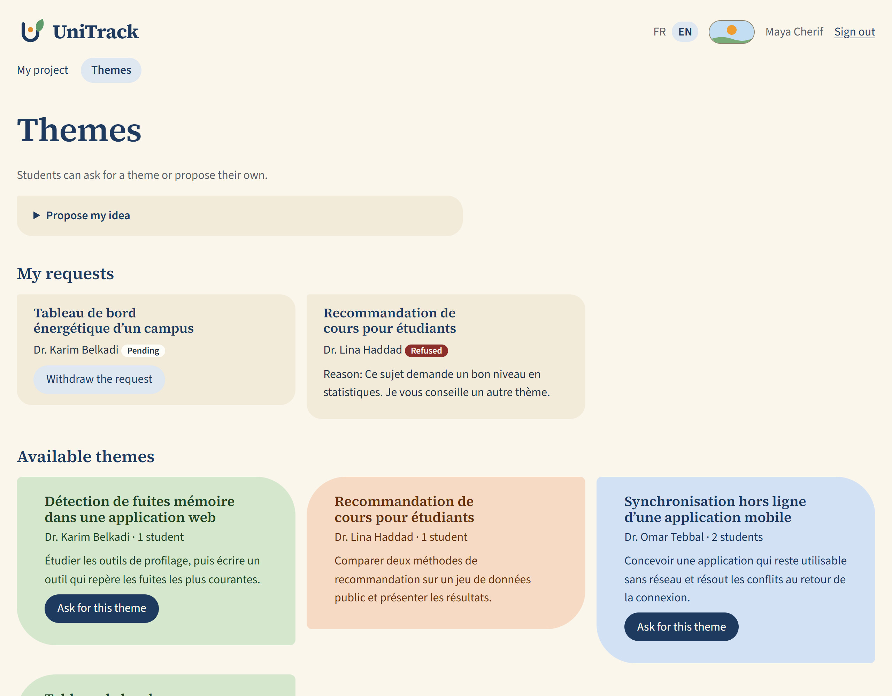
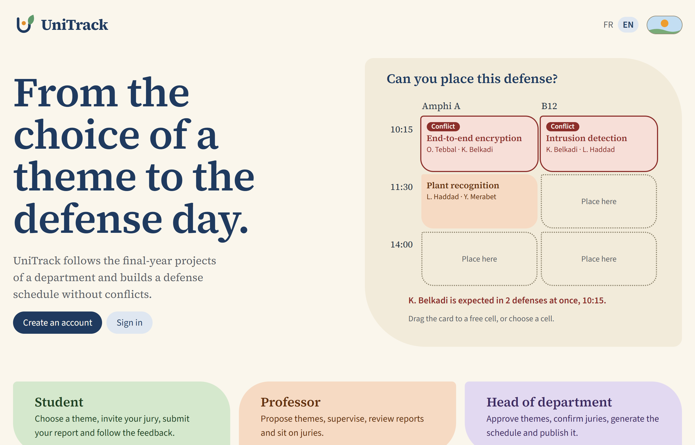
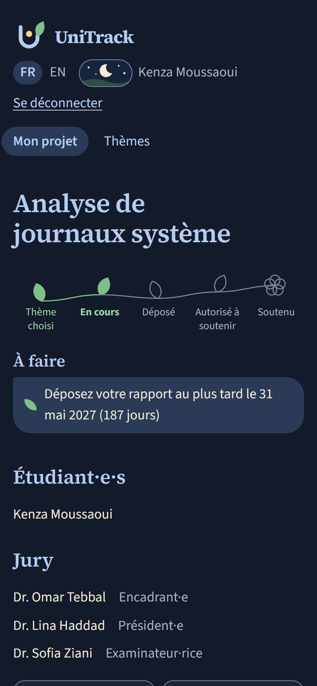

# UniTrack

UniTrack helps a university department run its final-year projects (PFE, Master's theses), from
the choice of a theme to the mark, and build the defense schedule.



**Status:** working, not deployed and not used by a real department. It was checked on a local
Supabase stack (PostgreSQL, Auth, Storage), but not on a hosted project.

## The problem

Departments often track themes, supervisors and juries in spreadsheets and e-mails, and build the
defense calendar by hand. It takes days and produces conflicts: a professor expected in two rooms,
a room used twice, a jury member who is not available.

## Features

- **Main page.** Explains the app to visitors, with a small puzzle: resolve a schedule conflict.
  It runs the same conflict check as the planning board.
- **Three roles.** Students, professors (who supervise and sit on juries) and the head of
  department. A new account has no access until the head of department gives it a role.
- **Themes.** Professors publish project themes, students propose their own ideas, and the head of
  department approves them and opens or closes the period.
- **Supervision requests.** Students ask for a theme, at most three at a time. The professor
  accepts, which creates the project, or refuses with a reason. The head of department sees who
  still has no project.
- **Jury invitations.** The students or the supervisor invite professors, who accept or refuse. The
  head of department confirms the jury and sees how many juries each professor has.
- **Projects.** Title, students, supervisor, jury, and a status that moves from in progress to
  submitted, approved for defense, and defended.
- **Report versions.** Students upload PDF versions. The supervisor approves them or requests
  changes with a comment. The history cannot be edited.
- **Discussion.** Messages between the students of a project and their supervisor. Neither the jury
  nor the head of department can read them.
- **Next steps and deadline.** Each role sees what to do now. Reports submitted after the deadline
  are accepted and marked late.
- **Availability.** Professors declare the slots when they can attend.
- **Scheduler.** Generates a schedule that respects every hard constraint, or explains in plain
  language why none exists.
- **Planning board.** Rooms × slots grid with drag and drop, or select-then-place for touch and
  keyboard. Conflicts appear while you edit, and a schedule with conflicts cannot be saved.
- **Results.** The president of the jury enters a mark and remarks. Students see them once the head
  of department publishes the results.
- **French and English**, **day and night modes**.

## Screenshots

The people and projects shown are fictional.

**Planning board:** a conflict is explained as soon as it appears, and blocks saving.



**Night mode:** a schedule just generated.



**Student project (in French):** progress, what to do next, and jury invitations.



**Themes:** a student's requests and the catalogue.



| Main page | Phone |
|---|---|
|  |  |

## Stack

React 19, TypeScript, Vite, React Router, Supabase (PostgreSQL, Auth, Storage), Vitest, pgTAP.

## Architecture

```
Browser
├── student, professor and admin pages (React)
├── planning board ──► scheduler (plain TypeScript, no React, no Supabase)
└── supabase-js, with the user's token on each request
        │
        ▼
Supabase
├── Auth         sign-in
├── PostgreSQL   Row-Level Security decides what each user may read and change
└── Storage      private bucket for the PDFs, protected by the same rules
```

There is no custom server, so the database is the security boundary. React only hides what a
user cannot do.

| Folder | Content |
|---|---|
| `src/scheduler` | Conflict detection, solver and explanations |
| `src/planning` | Planning board, rooms, slots, published defenses |
| `src/projects` | Projects, juries, report versions |
| `src/landing` | Main page and its puzzle |
| `src/theme` | Day and night switch |
| `src/themes` | Project themes and supervision requests |
| `src/jury` | Jury invitations |
| `src/results` | Marks |
| `src/discussion` | Messages of a project |
| `src/nextSteps` | What each role has to do now |
| `src/auth`, `src/people`, `src/availability` | Sign-in, roles, availability |
| `src/messages` | All the text of the interface |
| `supabase/migrations` | Tables, triggers and policies |
| `supabase/tests` | Permission tests, and one scenario for the whole process |
| `supabase/demo-reports` | Fictional PDFs, uploaded by `supabase db reset` |

### From a theme to a mark

| Step | Who starts it | Who decides |
|---|---|---|
| Theme | Professor, or a student's idea | Professor (for an idea), then the head of department |
| Request | Student | Professor of the theme: the project is created |
| Jury | Students or supervisor | Invited professor, then the head of department |
| Report | Student | Supervisor |
| Defense | Head of department | The scheduler checks every constraint |
| Result | President of the jury | Head of department, who publishes it |

Policies, triggers and database functions control each step. They check who is asking, and lock
the rows involved so that two people who act at the same moment cannot, for example, give one
student two projects.

### How the scheduler works

It is a constraint satisfaction problem. Each approved project is a variable, and its domain is
the slots when the supervisor and the whole jury are available. The search is backtracking with
the MRV heuristic: it always places the project that has the fewest legal slots left.

Rooms are interchangeable, so the search only counts them and assigns them at the end. Trying
each room would explore the same failures again.

There are three outcomes:

- **Solved.**
- **Impossible.** Either a simple check found a reason (for example, a person has more defenses
  than they can attend), or the search tried everything. In that case the scheduler isolates a
  small group of projects that cannot fit together and tests which single change would help.
- **Gave up.** The step limit was reached. This proves nothing, so the app shows the best partial
  schedule and never claims that it is impossible.

## Setup

You need Node.js 22.12 or later and Docker.

```sh
npm install
npx supabase start          # creates the tables and the demo data, prints the publishable key
cp .env.example .env.local  # then fill in the publishable key
npm run dev
```

`npx supabase db reset` brings the demo data back to its first state. UniTrack only uses the
database, Auth, REST and Storage, so this smaller start is enough:

```sh
npx supabase start -x realtime,imgproxy,mailpit,postgres-meta,studio,edge-runtime,logflare,vector,supavisor
```

The demo data is fictional. Every demo account uses the password `unitrack-demo`:

| Account | Role |
|---|---|
| `admin@unitrack.test` | Head of department |
| `omar@unitrack.test` | Professor |
| `student11@unitrack.test` | Student with a project in progress |
| `student12@unitrack.test` | Student whose jury is being invited |
| `student14@unitrack.test` | Student without a project |
| `karim@unitrack.test` | Professor with requests to answer and a mark to enter |

On a hosted project, do not run `seed.sql`. Apply the migrations with `npx supabase db push`,
sign up in the app, then make that first account an admin in the SQL editor:

```sql
update public.profiles set role = 'admin'
where id = (select id from auth.users where email = 'you@example.com');
```

## Tests

```sh
npm test          # scheduler, planning, next steps, display rules and messages
npm run test:db   # permissions and the whole process, needs the local Supabase stack (keeps its data)
```

The solver is also compared with a brute-force search on 300 small random problems.

## Known limitations

- The search can give up on very tight problems, for example when almost every room is used in
  every slot. It also blocks the page while it runs.
- The database prevents two defenses in the same room and slot. Conflicts between people are
  checked in the app, where the head of department is the only one who edits the schedule.
- If two admins edit the schedule at the same time, the last one to save wins.
- All rooms are considered equivalent and always available.
- One defense session at a time, with no archive of past years.
- A file that was uploaded but whose submission failed stays in storage, invisible in the app.
- There is no password reset or email notification. New messages appear after a refresh.
- A theme takes one or two students, and a jury at most four members besides the supervisor.
- Results are published all together.
- Discussions have no "read" state: the reminder to answer stays until the person answers.
- `src/lib/types.ts` is written by hand and must follow the migrations.

## Future improvements

- Run the search in a Web Worker.
- Break MRV ties with the project that constrains the most others.
- Generate the database types with the Supabase CLI.
- Email notifications, and an archive of past years.

## Licence

All rights reserved: the code can be read here, but not reused without permission. See
[LICENSE](LICENSE). The fonts keep their own licence (SIL Open Font License 1.1).
